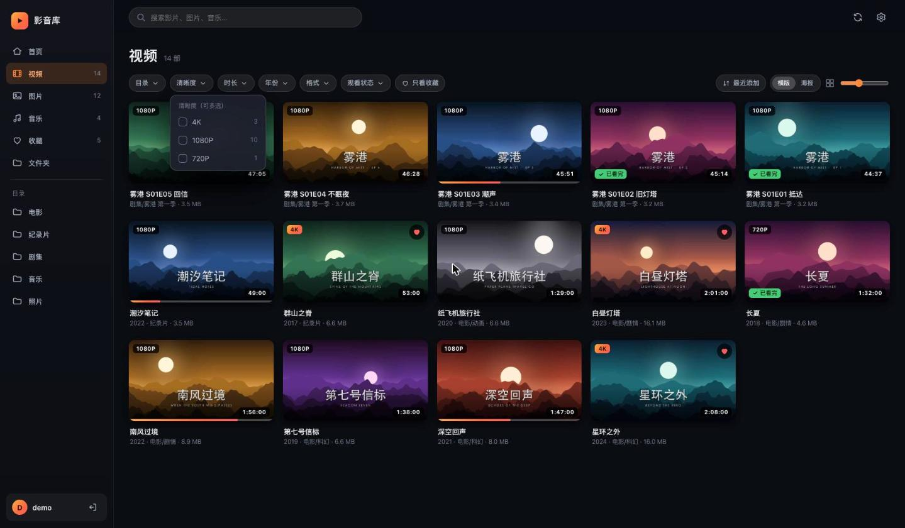
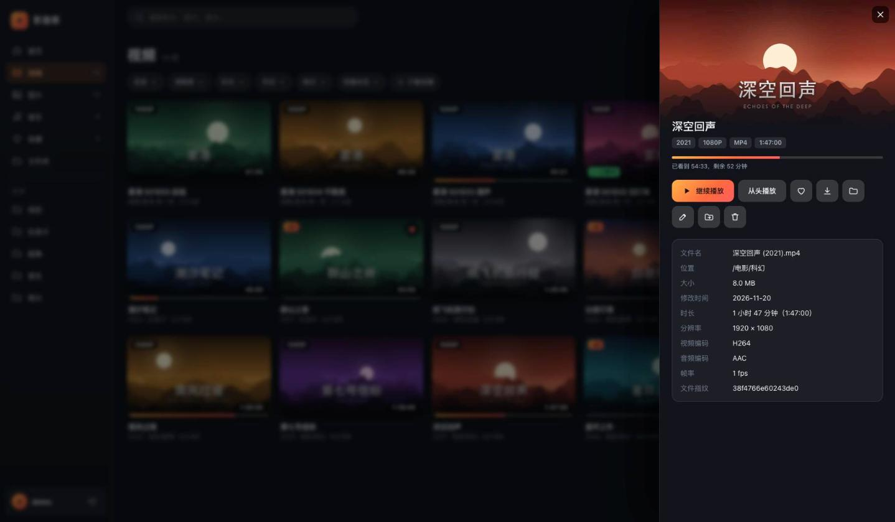
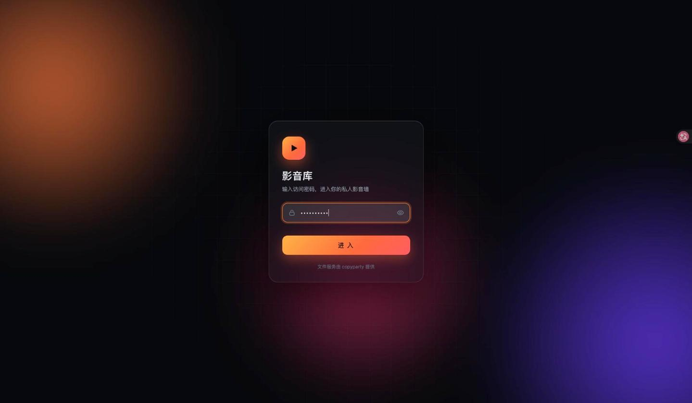

# copyparty-media-wall · 影音库

**A movie-wall front end for [copyparty](https://github.com/9001/copyparty).** Turns a copyparty file server into a private media library: poster wall, filters, favourites, resume playback, and floating multi-window players — with nothing to patch and no extra server.

[中文说明](README.zh-CN.md) · [Download for macOS](../../releases/latest) · [Manual setup](#manual-setup-any-os)


> Built on top of **[copyparty](https://github.com/9001/copyparty)** by [9001](https://github.com/9001) — the portable file server that does all the real work here (storage, indexing, thumbnails, accounts). This project is only a set of static pages that talk to copyparty's stock HTTP API. If you find it useful, go star copyparty first.

## Features

- **Media wall** — cover cards with resolution, duration, watch progress and "watched" marks; landscape or poster layout; adjustable card size; muted preview on hover.
- **Filter, sort, search** — by folder, resolution (4K / 1080P / …), duration, year, format, watch status, favourites; sort by date added, name, size, duration, last watched; instant search across the whole library.
- **Resume playback** — every video remembers where you stopped and continues from there, on any device.
- **Favourites and progress sync** — stored on your own server, shared between every browser that logs in.
- **Multi-window playback** — videos and images open in floating windows you can drag, resize, shrink to a corner, tile, or send fullscreen together. Mix several videos and photos on one screen.
- **Records follow the file** — each watched or favourited file gets a fingerprint (exact size + SHA-256 of its head, middle and tail). Rename it, move it, or switch libraries, and its progress and favourite are matched back automatically.
- **Export / import** watch history and favourites as a JSON file.
- **File management** — new folder, upload (drag and drop), rename, move, copy, delete, zip download, multi-select, right-click menu.
- **Several libraries** side by side, each a folder on disk.
- **Local artwork** — put `Movie.jpg` next to `Movie.mp4` and it becomes the cover.
- Works on phones (bottom navigation, touch-friendly windows). No build step, no dependencies, no CDN: three static files.

## Screenshots

| | |
|---|---|
|  Video wall and filters |  Resume where you left off |
|  Several videos and a photo at once |  Details panel |
|  File management with multi-select |  Login |

The artwork in these screenshots is generated by a script; no real films are shown.

## Quick start on macOS

1. Download `copyparty-media-wall-macos.zip` from [Releases](../../releases/latest) and unzip it.
2. Move **Copyparty** out of the unzipped folder (to Applications or the Desktop), then double-click it.
   The app is not signed with an Apple developer certificate, so the first launch is blocked: open **System Settings → Privacy & Security** and click **Open Anyway**.
3. Set a username and password, pick one or more folders, choose read-only or read-write.
4. Your browser opens the library. Other devices on the same network use the address shown in the dialog.

Double-click the app again to open the page, see the address, **manage shared folders**, or stop the service.

What the launcher does for you: generates the copyparty config, starts the bundled official `copyparty-sfx.py`, installs Pillow for image thumbnails into its own folder, and offers to download FFmpeg (for video covers) if none is installed. It needs Python 3; if it is missing, the launcher opens Apple's Command Line Tools installer.

## Manual setup (any OS)

You need [copyparty](https://github.com/9001/copyparty#quickstart) and this repository's `web/` folder.

1. Clone or download this repository.
2. Copy [`examples/copyparty.conf`](examples/copyparty.conf), replace the `/path/to/...` entries and the account line.
3. Run `python3 copyparty-sfx.py -c copyparty.conf` and open `http://<server>:3923/`.

For thumbnails, install Pillow (images) and FFmpeg (video covers, durations, resolutions) as described in the [copyparty docs](https://github.com/9001/copyparty#optional-dependencies).

The original copyparty interface stays available at `/media/` (Settings → 经典界面).

## How it works

- `/` is a copyparty volume containing `web/`, served with the `h` permission so the page loads before login.
- `/media` is your library. The page lists everything with one search request (`?srch`), browses folders with `?ls`, and shows thumbnails with `?th=`.
- `/.wallstate` is a small writable volume holding `state.json` (favourites and positions). Clients merge by timestamp, so several devices can use it at once.
- Move, copy, delete, mkdir and upload are copyparty's own API calls; permissions are enforced by copyparty.

Nothing in copyparty is modified, so updating copyparty does not break the front end.

## Limitations

- **No online metadata.** Covers come from video frames or local images; there is no TMDB-style scraping of posters, plots or cast.
- **No transcoding.** The browser plays the file as it is. HEVC, AC3/DTS audio, AVI, RMVB and similar may not play; the window then offers a download and a copyable link for IINA / VLC / Infuse.
- **The interface is in Simplified Chinese only** for now. Translations are welcome.
- The fingerprint samples three 64 KB blocks plus the exact size rather than hashing whole files, to avoid reading entire multi-gigabyte videos.
- Tested in Chrome on macOS. Safari and real phones have had only light testing.

## Security notes

- Connections are plain HTTP unless you put copyparty behind TLS. Use it on networks you trust.
- The macOS launcher stores the password in plain text in `~/Library/Application Support/copyparty/` (readable only by your user), because copyparty's config needs it.
- The optional FFmpeg download in the launcher comes from a third-party build site (`ffmpeg.martin-riedl.de`), since FFmpeg does not publish macOS binaries itself. Install FFmpeg yourself (for example with Homebrew) if you prefer; the launcher will use it and skip the download.

## Building the macOS app

```sh
sh macos/build.sh
```

Produces `dist/copyparty-media-wall-macos.zip`. The script compiles `macos/Copyparty.applescript`, fetches the latest official `copyparty-sfx.py`, and bundles `web/`.

## Credits and license

- [copyparty](https://github.com/9001/copyparty) by 9001, MIT license. The macOS download bundles its official single-file release, unmodified.
- This project is released under the [MIT license](LICENSE).
