<p align="center"><b>English</b> &nbsp;|&nbsp; <a href="README.zh-CN.md">简体中文</a></p>

# copyparty-media-wall · 影音库

**A movie-wall front end for [copyparty](https://github.com/9001/copyparty).** Turns a copyparty file server into a private media library: poster wall, filters, favourites, resume playback, and floating multi-window players — with nothing to patch and no extra server.

[Download](#download) · [Manual setup](#manual-setup-any-os) · [Screenshots](#several-videos-at-once)

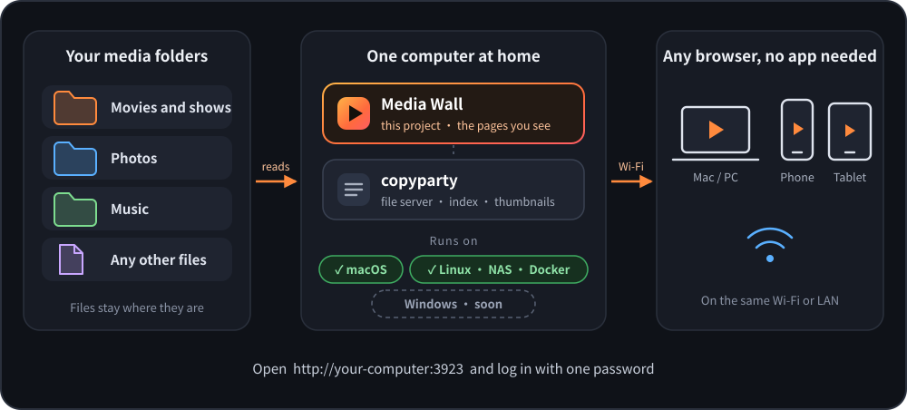

**In one sentence:** point it at the folders that hold your films, photos, music and any other files on one computer, and every computer, phone and tablet on your network gets a media library and a shared file space in the browser — nothing to install on them.

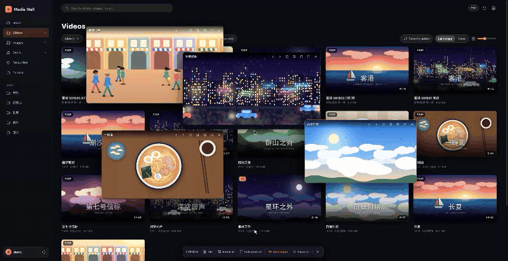

<sub>Recorded from the real page: every window is a playing video. Drag them anywhere, resize them, then press <b>Tile</b>.</sub>

> Built on top of **[copyparty](https://github.com/9001/copyparty)** by [9001](https://github.com/9001) — the portable file server that does all the real work here (storage, indexing, thumbnails, accounts). This project is only a set of static pages that talk to copyparty's stock HTTP API. If you find it useful, go star copyparty first.

## Features

- **Media wall** — cover cards with resolution, duration, watch progress and "watched" marks; landscape or poster layout; adjustable card size; muted preview on hover.
- **Filter, sort, search** — by folder, resolution (4K / 1080P / …), duration, year, format, watch status, favourites; sort by date added, name, size, duration, last watched; instant search across the whole library.
- **Resume playback** — every video remembers where you stopped and continues from there, on any device.
- **Favourites and progress sync** — stored on your own server, shared between every browser that logs in.
- **Play several videos at once** — every video opens in its own floating window inside the page. Open as many as you like, drag and resize them freely, tile them, shrink them to a corner while you keep browsing, or put them all fullscreen together as a video wall. Photos open the same way and can sit next to the videos.
- **English and 中文** — switch with the button at the top right.
- **Records follow the file** — each watched or favourited file gets a fingerprint (exact size + SHA-256 of its head, middle and tail). Rename it, move it, or switch libraries, and its progress and favourite are matched back automatically.
- **Export / import** watch history and favourites as a JSON file.
- **File sharing on your network** — it is still a file server underneath: every kind of file in the shared folders can be browsed, opened and downloaded from any device, whole folders download as a zip, and with read-write access other devices can upload into them. Handy for getting files between a phone and a computer.
- **Share links** — give someone a link to one file or folder that opens without the password and expires when you choose.
- **File management** — new folder, upload (drag and drop), rename, move, copy, delete, zip download, multi-select, right-click menu.
- **Several libraries** side by side, each a folder on disk.
- **Local artwork** — put `Movie.jpg` next to `Movie.mp4` and it becomes the cover.
- Works on phones (bottom navigation, touch-friendly windows). No build step, no dependencies, no CDN: three static files.

## Several videos at once

This is the part that file servers and most media libraries do not do: playback happens in windows inside the page, so more than one thing can play at a time.

**Floating windows** — drag them anywhere, resize from any edge, stack them over the library.

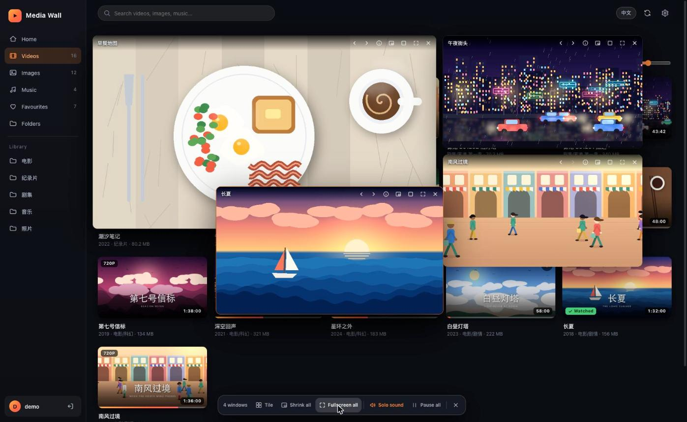

**Tiled** — one click arranges every open window into a video wall; one more puts the whole wall fullscreen. The animation at the top of this page ends in this layout.

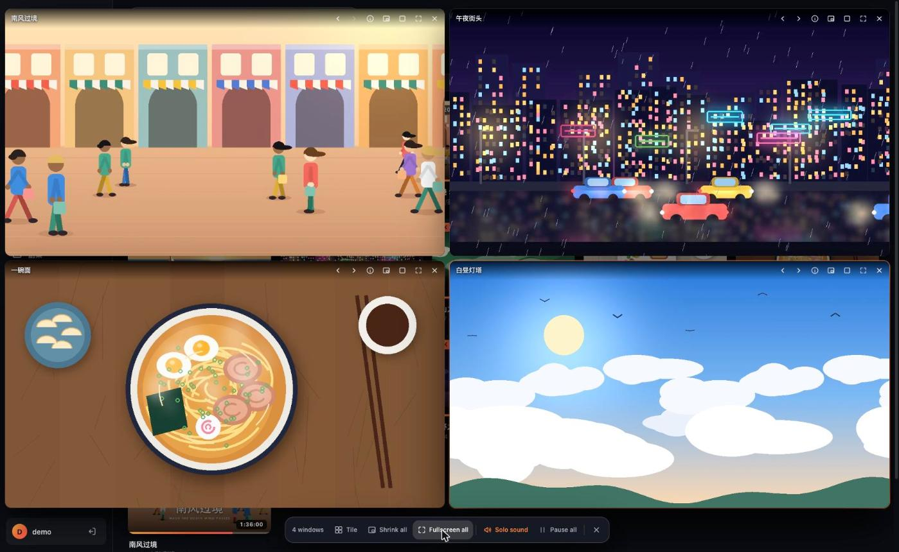

**Keep browsing while they play** — shrink the players to a corner and carry on through the library.

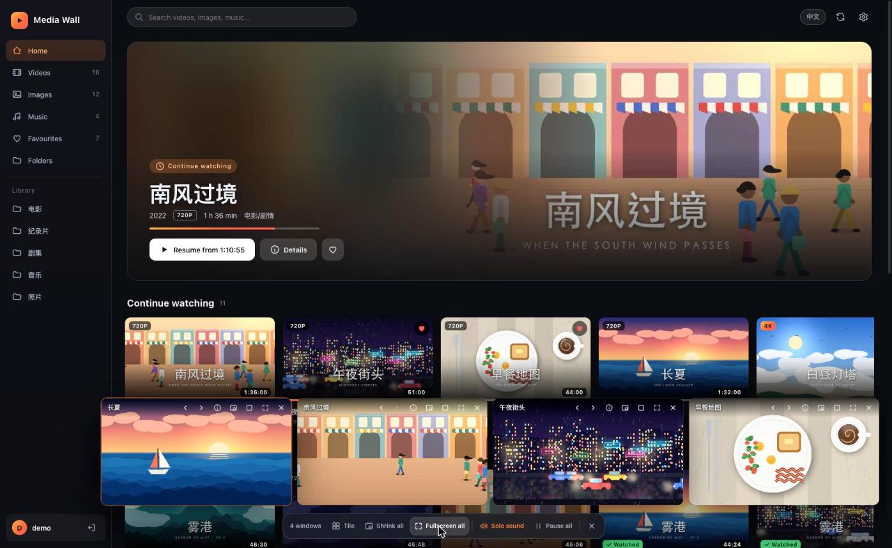

Each window has previous / next, details, shrink, fill-page, fullscreen and close. The dock at the bottom tiles the windows, toggles between "sound from the active window only" and "sound from all", and pauses or closes everything at once.

## Also a shared file space

The wall is the friendly face, but the folders you share are shared as files too, not only as a media library:

- **Any file type.** Documents, archives, installers and everything else show up under **Folders** next to the media, with size and date, and open or download with a click.
- **Download** single files, several selected files, or a whole folder as one zip.
- **Upload from any device** by dragging files onto the page or with the Upload button — for example, send photos from a phone straight into a folder on the computer.
- **Organise** with new folders, rename, move and copy, across libraries.
- **One password** protects everything; choose read-only or read-write when you start the service.

### Share links

Right-click a file or folder (or select several files and press **Share**) to create a link that opens **without the password**. Whoever has the link sees only what you shared — one file, a few files from one folder, or one folder — and nothing else in the library.

- Pick how long the link lives: 1 hour, 1 day, 7 days, or until you revoke it.
- Revoke links any time from **Settings → Manage share links**.
- A link to a single file opens the file directly; a link to a folder or several files opens copyparty's own file list.
- The link points at your server, so it works wherever the server can be reached — normally the same Wi-Fi or LAN. It is not an internet link unless you have made the server reachable from outside yourself.
- Share links are a copyparty feature (`shr` in the config); this front end adds the buttons.

## More screenshots

| | |
|---|---|
| 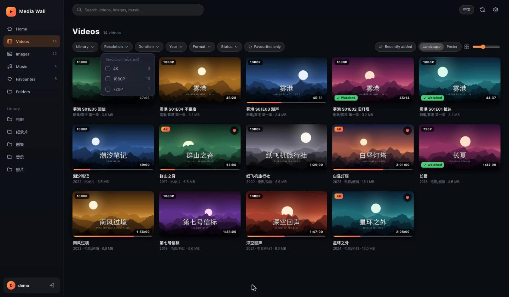 Video wall and filters | 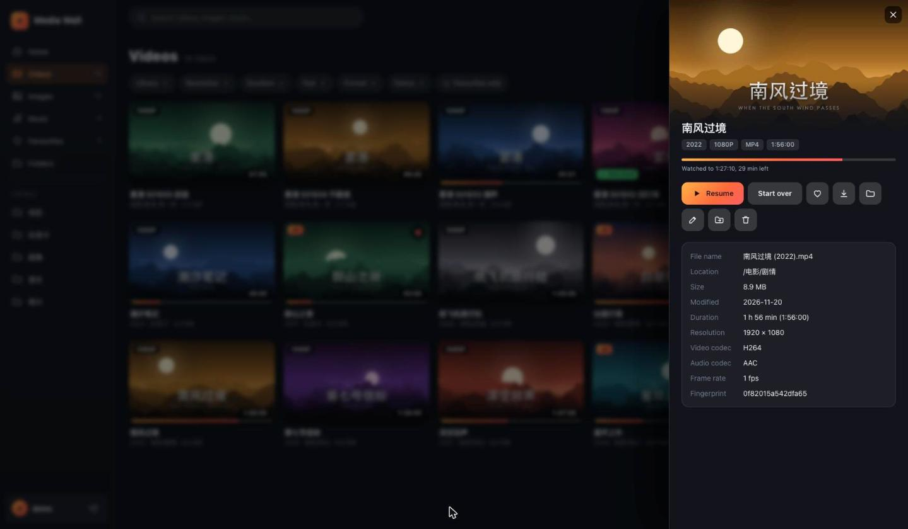 Details and watch progress |
| 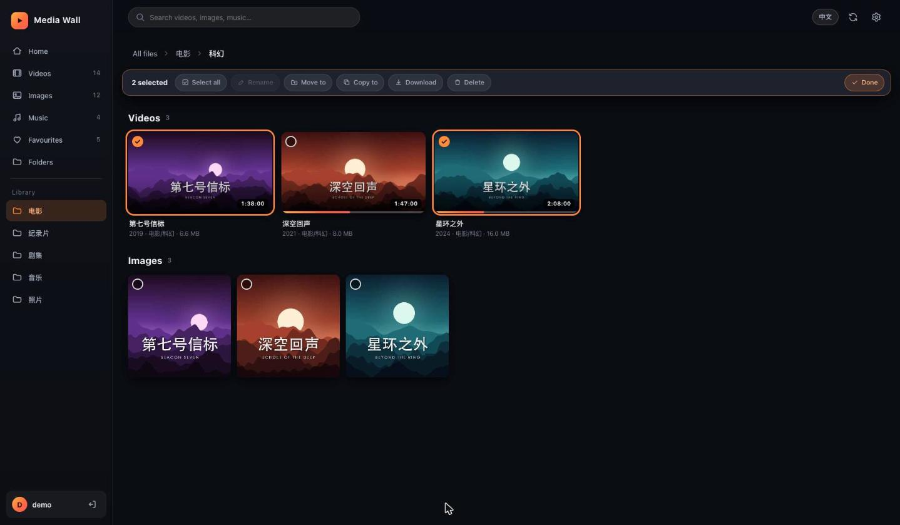 File management with multi-select | 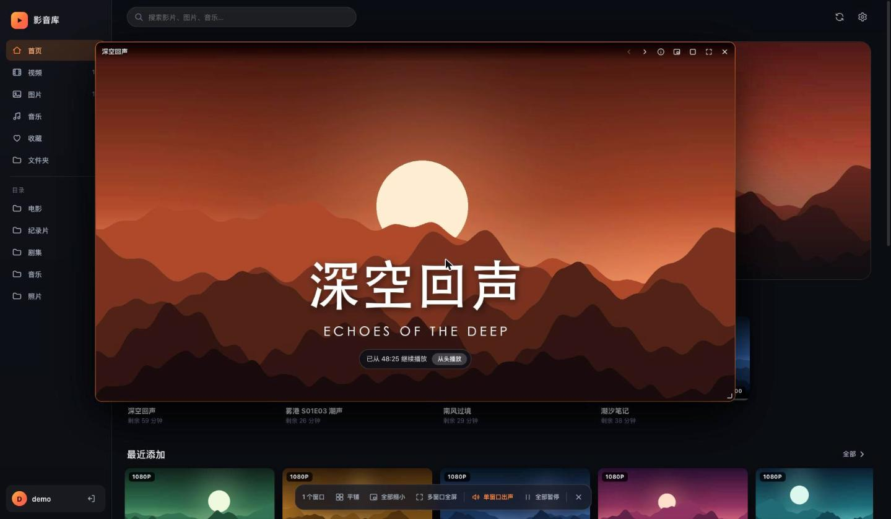 Resume where you left off (中文 interface) |

Every video and picture in these screenshots was drawn by a script for this demo (people, street, food, sky, sea); no real films are shown.

## Download

| Platform | Download | Notes |
|---|---|---|
| **macOS** (Apple silicon and Intel) | [copyparty-media-wall-macos.zip](../../releases/latest/download/copyparty-media-wall-macos.zip) | Double-click launcher, see below |
| **Windows** 10 / 11, 64-bit | [copyparty-media-wall-windows.zip](../../releases/latest/download/copyparty-media-wall-windows.zip) | New. Nothing to install, see [below](#quick-start-on-windows) |
| **Linux / NAS / Docker** | No package needed | Use the [manual setup](#manual-setup-any-os) with your own copyparty |

## Quick start on macOS

1. Download `copyparty-media-wall-macos.zip` from the table above and unzip it.
2. Move **Copyparty** out of the unzipped folder (to Applications or the Desktop), then double-click it.
   The app is not signed with an Apple developer certificate, so the first launch is blocked: open **System Settings → Privacy & Security** and click **Open Anyway**.
3. Your browser opens a setup page. Follow its steps: create the login, add your media folders, choose read-only or read-write, and optionally download FFmpeg for video covers.
4. The service starts and the page shows the address for this computer and for the other devices on your network.

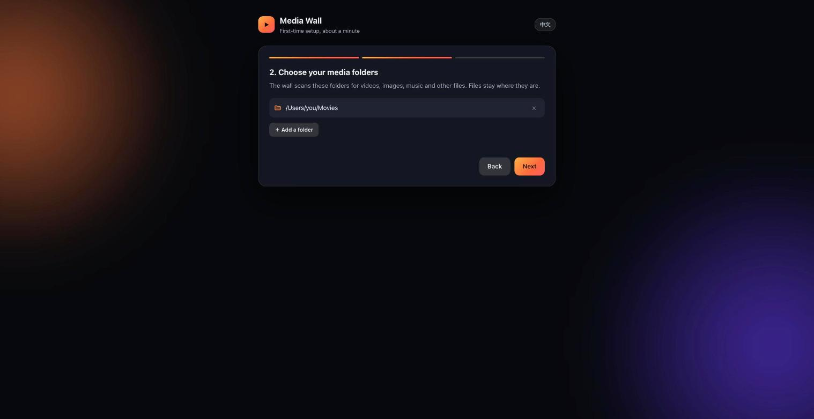

Double-click the app again any time to get the control page: open the library, copy the address, add or remove folders, change the password or the permission, stop or restart the service.

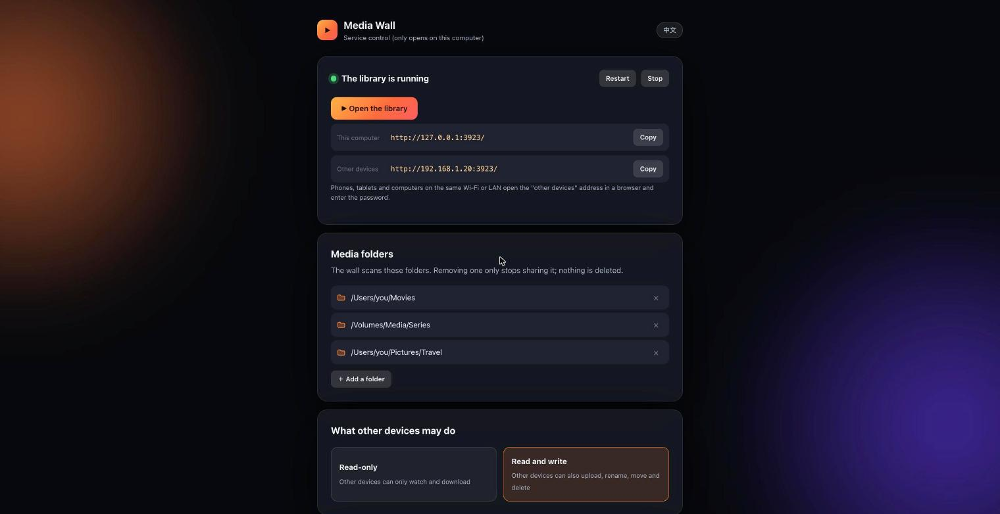

How this works: the app starts a small helper (`wall-helper.py`, Python standard library only) that serves the setup page on `127.0.0.1` and does what a web page cannot do by itself — browse folders on disk, write the copyparty config, fetch FFmpeg and Pillow, start and stop the bundled official `copyparty-sfx.py`. The setup page only opens on the computer it runs on; other devices get the library, never the controls. It needs Python 3; if that is missing, the app opens Apple's Command Line Tools installer.

## Quick start on Windows

1. Download `copyparty-media-wall-windows.zip` from the table above and unzip the whole folder to a place you want to keep it.
2. Double-click **Media Wall.bat**. Windows may say "Windows protected your PC" because the package is not code-signed: click **More info**, then **Run anyway**.
3. Your browser opens the same setup page as on macOS: create the login, add folders (the folder browser lists your drives), choose the permission, optionally download FFmpeg for video covers (about 140 MB).
4. When Windows Firewall asks about Python, allow it on private networks, otherwise other devices cannot connect.

Nothing is installed and no Python is needed: the folder carries the official embeddable Python, Pillow, and the official `copyparty-sfx.py`. Settings live in `%APPDATA%\copyparty-media-wall`.

How it was tested: the package is built and exercised end to end on GitHub's Windows servers on every change (setup API, start, login, index with non-ASCII names, thumbnails, upload, share links, FFmpeg download, video covers, stop — see `windows/smoke_test.py`). It has **not** yet been clicked through by a person on a Windows 10 or 11 desktop, so the double-click, the SmartScreen and firewall prompts, and the pages in Edge are untested. Reports are welcome.

## Manual setup (any OS)

You need [copyparty](https://github.com/9001/copyparty#quickstart) and this repository's `web/` folder.

1. Clone or download this repository.
2. Copy [`examples/copyparty.conf`](examples/copyparty.conf), replace the `/path/to/...` entries and the account line.
3. Run `python3 copyparty-sfx.py -c copyparty.conf` and open `http://<server>:3923/`.

For thumbnails, install Pillow (images) and FFmpeg (video covers, durations, resolutions) as described in the [copyparty docs](https://github.com/9001/copyparty#optional-dependencies).

The original copyparty interface stays available at `/media/` (Settings → 经典界面).

## How it works

- `/` is a copyparty volume containing `web/`, served with the `h` permission so the page loads before login.
- `/media` is your library. The page lists everything with one search request (`?srch`), browses folders with `?ls`, and shows thumbnails with `?th=`.
- `/.wallstate` is a small writable volume holding `state.json` (favourites and positions). Clients merge by timestamp, so several devices can use it at once.
- Move, copy, delete, mkdir and upload are copyparty's own API calls; permissions are enforced by copyparty.

Nothing in copyparty is modified, so updating copyparty does not break the front end.

## Limitations

- **No online metadata.** Covers come from video frames or local images; there is no TMDB-style scraping of posters, plots or cast.
- **No transcoding.** The browser plays the file as it is. HEVC, AC3/DTS audio, AVI, RMVB and similar may not play; the window then offers a download and a copyable link for IINA / VLC / Infuse.
- The library and the setup page are in English and Simplified Chinese. More translations are welcome.
- The fingerprint samples three 64 KB blocks plus the exact size rather than hashing whole files, to avoid reading entire multi-gigabyte videos.
- Tested in Chrome on macOS. Safari and real phones have had only light testing.

## Security notes

- The setup and control page listens on `127.0.0.1` only. It also checks the `Host` header, needs a secret token that the app hands to your browser, and requires a custom request header, so other devices on the network and other websites in your browser cannot use it.

- Connections are plain HTTP unless you put copyparty behind TLS. Use it on networks you trust.
- The macOS app stores the password in plain text in `~/Library/Application Support/copyparty/` (readable only by your user), because copyparty's config needs it.
- The optional FFmpeg download on the setup page comes from a third-party build site (`ffmpeg.martin-riedl.de`), since FFmpeg does not publish macOS binaries itself. Install FFmpeg yourself (for example with Homebrew) if you prefer; it will be used and the download step is skipped.

## Building the macOS app

```sh
sh macos/build.sh
```

Produces `dist/copyparty-media-wall-macos.zip`. The script compiles `macos/Copyparty.applescript` (a thin launcher), fetches the latest official `copyparty-sfx.py`, and bundles `web/`, the helper and the setup page.

## Credits and license

- [copyparty](https://github.com/9001/copyparty) by 9001, MIT license. The macOS download bundles its official single-file release, unmodified.
- This project is released under the [MIT license](LICENSE).
