<p align="center"><a href="README.md">English</a> &nbsp;|&nbsp; <b>简体中文</b></p>

# copyparty-media-wall · 影音库

**给 [copyparty](https://github.com/9001/copyparty) 做的电影墙界面。** 把 copyparty 文件服务器变成私人影音库：封面墙、筛选、收藏、续播、可自由摆放的多窗口播放。不改 copyparty 一行代码，也不需要额外的服务。

[下载](#下载) · [手动部署](#手动部署任意系统) · [界面展示](#多个视频同时播放)

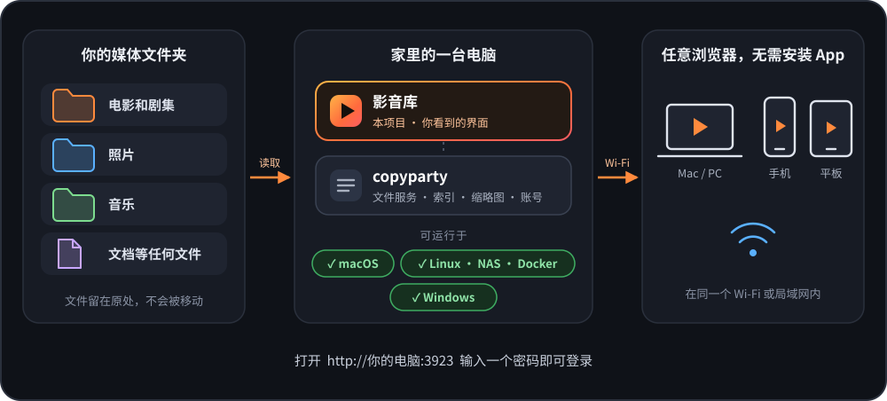

**一句话：** 在一台电脑上指定存放电影、照片、音乐和其他任何文件的文件夹，局域网里的所有电脑、手机、平板打开浏览器就有一个影音库和一块共享文件空间，它们什么都不用装。

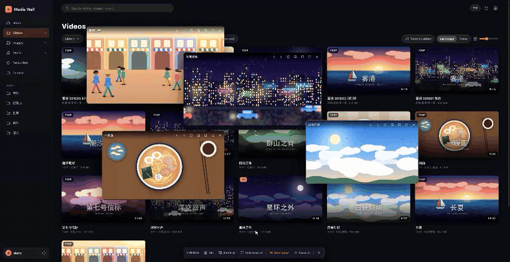

> 本项目建立在 [9001](https://github.com/9001) 的 **[copyparty](https://github.com/9001/copyparty)** 之上。存储、索引、缩略图、账号这些真正的工作都是 copyparty 完成的，本项目只是一组调用它标准 HTTP 接口的静态页面。觉得好用，请先去给 copyparty 点个 star。

## 功能

- **封面墙**：卡片显示清晰度、时长、观看进度和"已看完"标记；横版 / 海报两种布局；卡片大小可调；鼠标悬停静音预览。
- **筛选、排序、搜索**：按目录、清晰度（4K / 1080P…）、时长、年份、格式、观看状态、是否收藏筛选；按添加时间、名称、大小、时长、最近观看排序；全库即时搜索。
- **续播**：每个视频记住看到的位置，下次打开直接从那里继续，换设备也一样。
- **收藏和进度同步**：保存在你自己的服务器上，所有登录的浏览器共用一份。
- **多个视频同时播放**：每个视频都在页面内自己的浮动窗口里打开。想开几个开几个，可以自由拖动和缩放、平铺、缩到角落继续浏览，或者一键让所有窗口一起全屏，变成视频墙。照片也用同样的方式打开，可以和视频摆在一起。
- **中文 / English 双语**：右上角按钮一键切换。
- **记录跟着文件走**：看过或收藏过的文件会记下指纹（精确大小 + 头、中、尾三段的 SHA-256）。改名、移动、换目录之后，进度和收藏会自动匹配回来。
- **导出 / 导入**播放记录和收藏（JSON 文件）。
- **局域网文件共享**：它底层仍然是文件服务器。共享文件夹里任何类型的文件，都能在任意设备上浏览、打开、下载；整个文件夹可以打包成 zip 下载；开了读写权限后，其他设备还能往里上传。手机和电脑之间互传文件很方便。
- **文件管理**：新建文件夹、上传（支持拖拽）、重命名、移动、复制、删除、打包下载、多选、右键菜单。
- **多个媒体目录**并列，每个对应磁盘上的一个文件夹。
- **本地封面**：在 `电影.mp4` 旁边放一张 `电影.jpg`，它就是封面。
- 手机可用（底部导航、可触摸拖动的窗口）。没有构建步骤、没有依赖、不走 CDN，就是三个静态文件。

## 多个视频同时播放

这是文件服务器和大多数影音库没有的能力：播放发生在页面内的窗口里，所以可以同时放不止一个。

**浮动窗口**：可以拖到任意位置、从任意边缘缩放，叠在片库上面。

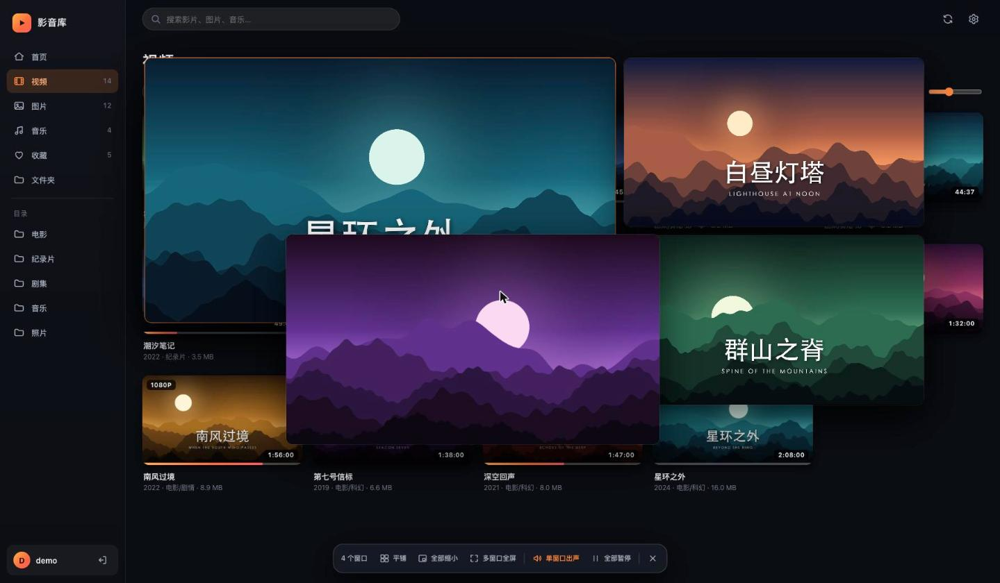

**平铺**：点一下，所有打开的窗口排成一面视频墙；再点一下整面墙一起全屏。本页顶部的动图就是这个布局，从真实页面录制。

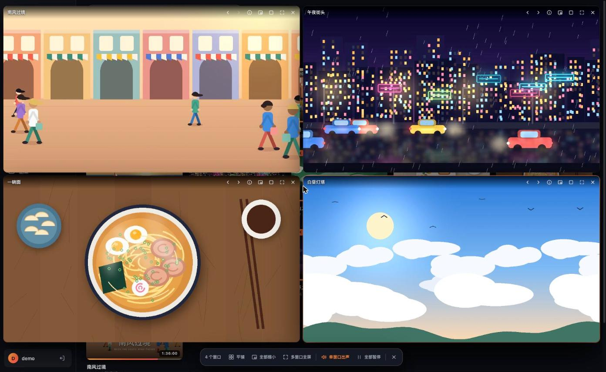

**边浏览边播放**：把播放窗口缩到角落，继续翻看片库。

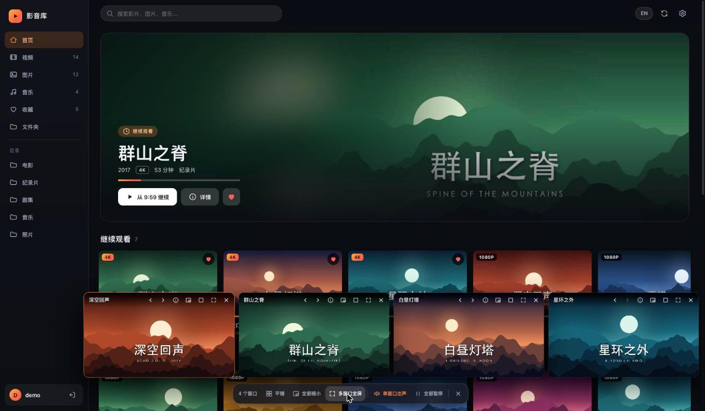

每个窗口都有上一个 / 下一个、详情、缩小、铺满页面、全屏、关闭。底部工具条可以平铺所有窗口、在"只让当前窗口出声"和"全部出声"之间切换、一键全部暂停或全部关闭。

## 同时也是共享文件空间

电影墙是好看的那一面，但你共享的文件夹同时也是作为"文件"共享的，不只是影音库：

- **任何类型的文件**：文档、压缩包、安装包等都会出现在「文件夹」页面里，和媒体文件放在一起，显示大小和日期，点一下就能打开或下载。
- **下载**：单个文件、勾选的多个文件，或者把整个文件夹打包成一个 zip。
- **任意设备上传**：把文件拖进页面，或者点「上传」。比如把手机里的照片直接传到电脑上的某个文件夹。
- **整理**：新建文件夹、重命名、移动、复制，可以跨媒体目录。
- **一个密码**保护全部内容；启动服务时选择只读或可读写。

目前还不支持的：给单个文件或文件夹生成公开分享链接（发给没有密码的人也能打开的那种）。copyparty 本身有这个能力，这个界面还没有接入。

## 更多界面

| | |
|---|---|
| 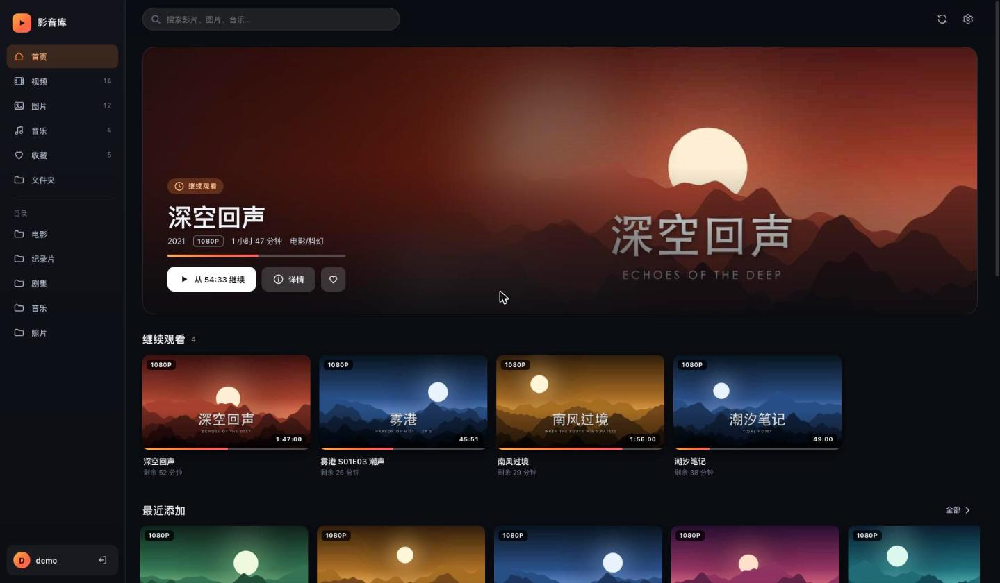 首页：继续观看、最近添加 | 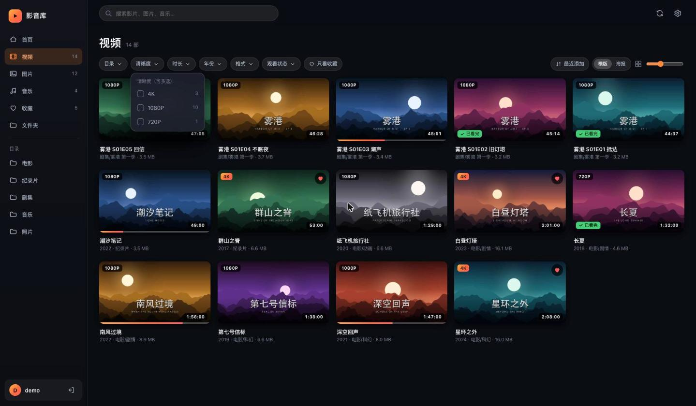 视频墙和筛选 |
| 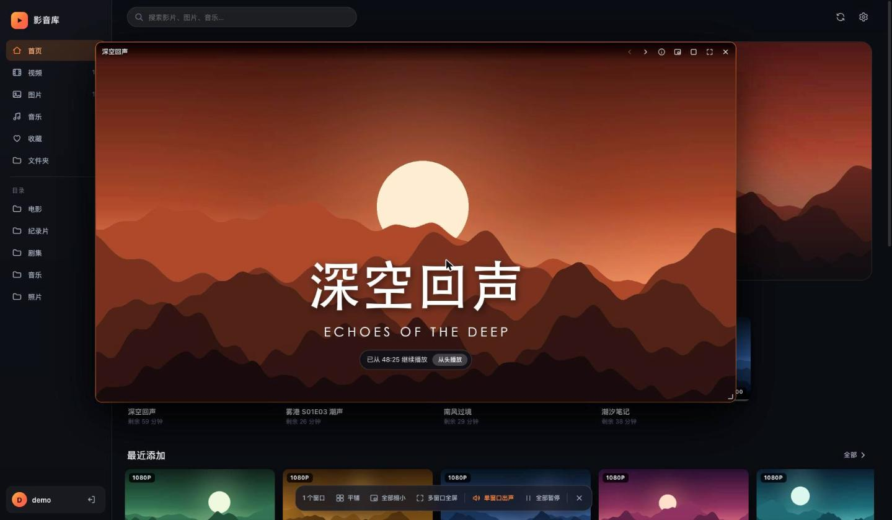 从上次的位置继续 | 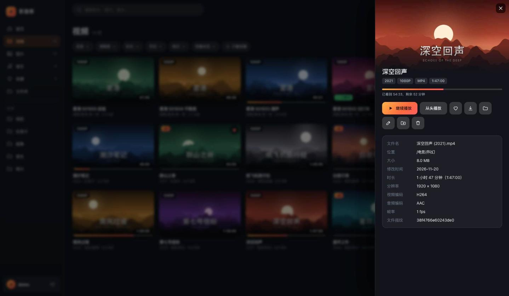 详情面板 |
| 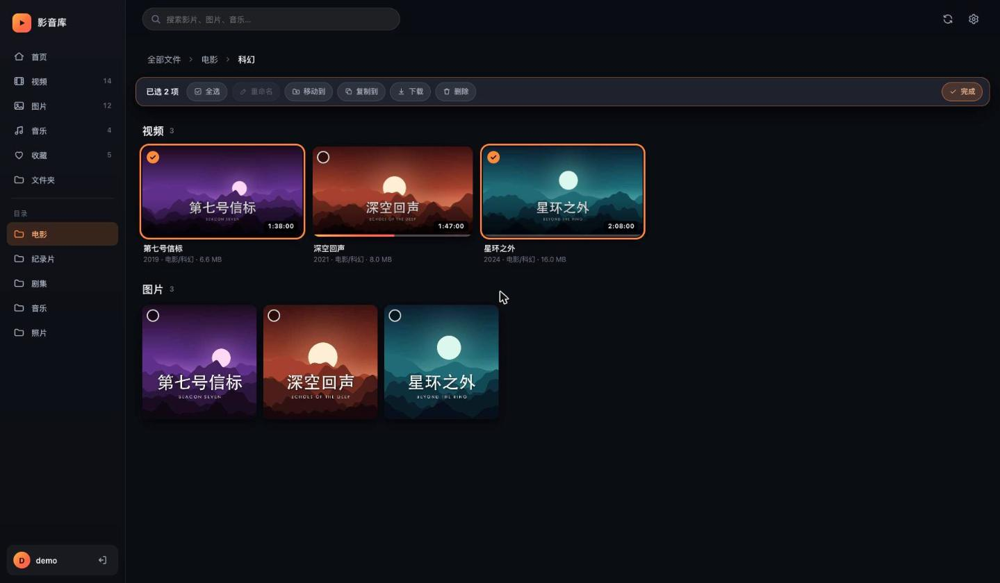 文件管理和多选 | 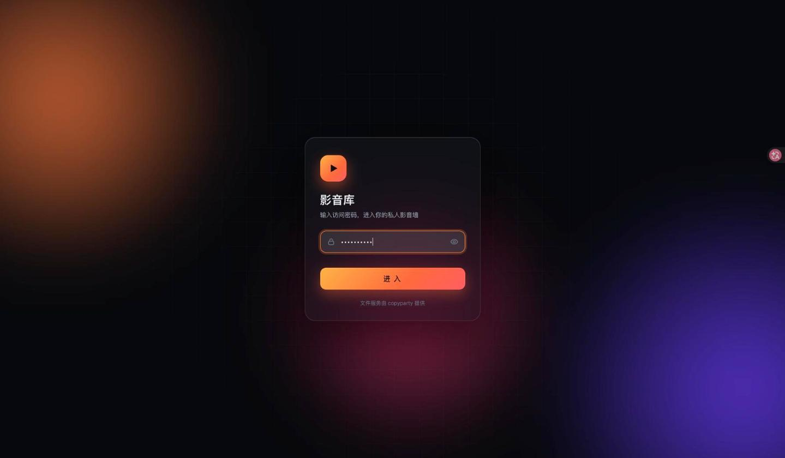 登录页 |

截图里的视频和图片（行人、街景、美食、天空、海面）都是为演示用脚本绘制的，不是真实影片。

## 下载

| 平台 | 下载地址 | 说明 |
|---|---|---|
| **macOS**（Apple 芯片和 Intel） | [copyparty-media-wall-macos.zip](../../releases/latest/download/copyparty-media-wall-macos.zip) | 双击启动，见下文 |
| **Windows** | 即将推出，暂未提供 | 目前可按[手动部署](#手动部署任意系统)使用 |
| **Linux / NAS / Docker** | 不需要安装包 | 用自己的 copyparty 按[手动部署](#手动部署任意系统)配置 |

## macOS 快速开始

1. 从上面的表格下载 `copyparty-media-wall-macos.zip` 并解压。
2. 把 **Copyparty** 从解压出的文件夹里拖出来（拖到「应用程序」或桌面），再双击。
   应用没有苹果开发者签名，第一次打开会被拦截：到 **系统设置 → 隐私与安全性** 里点 **仍要打开**。
3. 设置用户名和密码，选择一个或多个文件夹，选择只读或可读写。
4. 浏览器会自动打开影音库。同一网络下的其他设备用弹窗里显示的地址访问。

再次双击应用，可以打开页面、查看地址、**管理共享目录**、停止服务。

启动器替你做的事：生成 copyparty 配置，启动内置的官方 `copyparty-sfx.py`，把 Pillow（图片缩略图）装到它自己的目录里，并在没有 FFmpeg 时询问是否下载（用于视频封面）。它需要 Python 3；没有的话会打开苹果的命令行开发者工具安装窗口。

## 手动部署（任意系统）

需要 [copyparty](https://github.com/9001/copyparty#quickstart) 和本仓库的 `web/` 目录。

1. 克隆或下载本仓库。
2. 复制 [`examples/copyparty.conf`](examples/copyparty.conf)，把里面的 `/path/to/...` 和账号那一行改成你自己的。
3. 运行 `python3 copyparty-sfx.py -c copyparty.conf`，打开 `http://<服务器地址>:3923/`。

缩略图需要 Pillow（图片）和 FFmpeg（视频封面、时长、分辨率），安装方法见 [copyparty 文档](https://github.com/9001/copyparty#optional-dependencies)。

copyparty 原来的界面仍然可用，地址是 `/media/`（设置 → 经典界面）。

## 工作原理

- `/` 是一个放着 `web/` 的 copyparty 卷，用 `h` 权限提供，所以登录前就能加载页面。
- `/media` 是你的媒体库。页面用一次搜索请求（`?srch`）列出全部文件，用 `?ls` 浏览目录，用 `?th=` 取缩略图。
- `/.wallstate` 是一个小的可写卷，里面的 `state.json` 保存收藏和进度。各设备按时间戳合并，可以同时使用。
- 移动、复制、删除、新建文件夹、上传都是 copyparty 自己的接口，权限由 copyparty 控制。

copyparty 本身没有任何改动，所以升级 copyparty 不会影响这个界面。

## 限制

- **没有联网刮削。** 封面来自视频截图或本地图片，不会自动下载海报、简介、演员表。
- 网页界面支持中文和英文；macOS 启动器自己的弹窗目前只有中文。
- **不转码。** 浏览器直接播放原文件。HEVC、AC3/DTS 音轨、AVI、RMVB 等可能放不了，这时窗口会提供下载和可复制的链接，用 IINA / VLC / Infuse 打开。
- 指纹取的是三段各 64 KB 的内容加精确大小，而不是整个文件的哈希，以免把几十 GB 的视频完整读一遍。
- 在 macOS 的 Chrome 上测试过。Safari 和真实手机只做了少量测试。

## 安全说明

- 除非你给 copyparty 配了 TLS，否则连接是明文 HTTP，请只在可信的网络里使用。
- macOS 启动器把密码明文保存在 `~/Library/Application Support/copyparty/`（只有你的账户能读），因为 copyparty 的配置需要它。
- 启动器里可选的 FFmpeg 下载来自第三方构建站点（`ffmpeg.martin-riedl.de`），因为 FFmpeg 官方不提供 macOS 的现成程序。你也可以自己安装 FFmpeg（比如用 Homebrew），启动器会直接使用并跳过下载。

## 构建 macOS 应用

```sh
sh macos/build.sh
```

生成 `dist/copyparty-media-wall-macos.zip`。脚本会编译 `macos/Copyparty.applescript`，下载最新的官方 `copyparty-sfx.py`，并打包 `web/`。

## 致谢和许可

- [copyparty](https://github.com/9001/copyparty)，作者 9001，MIT 许可。macOS 下载包内置的是它未经修改的官方单文件版。
- 本项目以 [MIT 许可](LICENSE) 发布。
